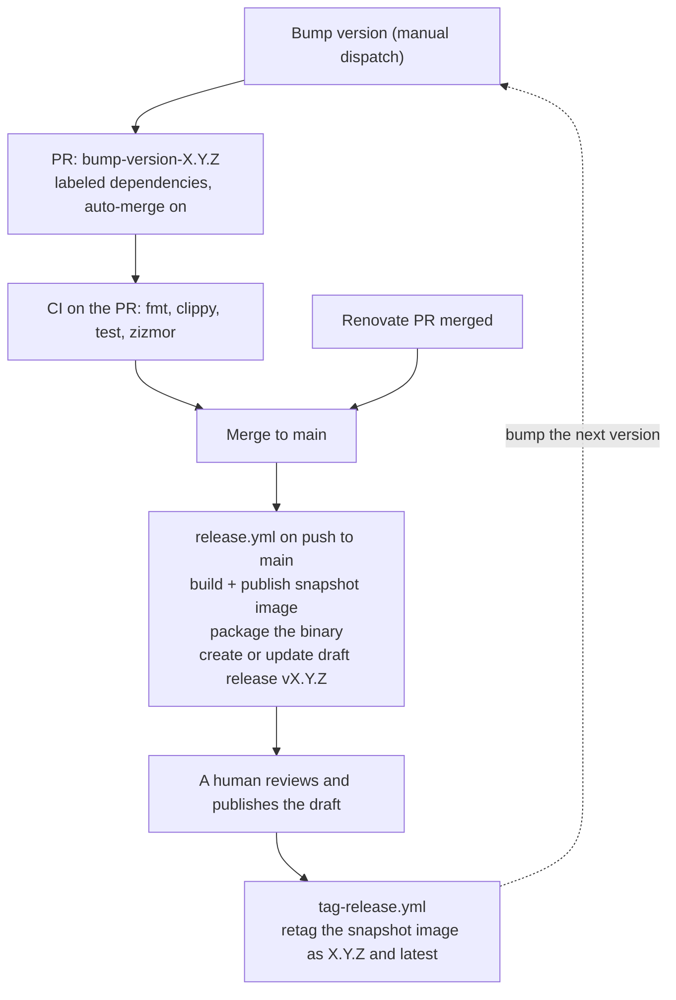

# Calendar Proxy — CI/CD

All automation lives in `.github/workflows/`. Five workflows handle checking the
code, building and publishing a container image, turning a merged version into a
published release, and keeping dependencies current.

## Workflows at a glance

| Workflow | File | Runs on | What it does |
|---|---|---|---|
| CI | `ci.yml` | PR targeting `main`, push to `main` | Format check, clippy, tests, plus a zizmor scan of the workflow files |
| Build and Release | `release.yml` | Push to `main` | Builds a snapshot OCI image, extracts the binary, creates or updates a draft release |
| Tag release image | `tag-release.yml` | A release is published | Retags the snapshot image as the release version and `latest` |
| Bump version | `bump-version.yml` | Manual (`workflow_dispatch`) | Bumps `Cargo.toml`, opens a PR, enables auto-merge |
| Renovate | `renovate.yml` | Daily at 04:00 UTC, or manual | Runs self-hosted Renovate to open dependency PRs |

## CI (`ci.yml`)

Two jobs, both on `ubuntu-latest`.

The `test` job installs the stable Rust toolchain and runs `cargo fmt -- --check`,
`cargo clippy -- -D warnings`, and `cargo test`.

The `zizmor` job scans the workflow files for security problems and uploads the
results to code scanning, which is why it needs `security-events: write`. The list
of files it scans is written out by hand under `inputs`. A new workflow file only
gets scanned if it is added to that list.

Workflow-level permissions are `contents: read`; the zizmor job adds the extra
scope it needs.

## Dependency automation (`renovate.yml`)

Self-hosted Renovate runs daily at 04:00 UTC and on demand. It authenticates with
the `RENOVATE_TOKEN` secret and reads `renovate.json` for its rules: Cargo and
GitHub Actions managers, a 7-day minimum release age, Actions pinned to commit
digests, and the `dependencies` label on everything it opens.

Renovate pushes branches with its own token, so when a Renovate PR merges, the
push to `main` triggers `release.yml` the same way a hand-made merge would.
Grouped Rust dependency updates auto-merge; major Rust updates and Actions digest
updates wait for approval on the dashboard.

## Version bump (`bump-version.yml`)

Manual dispatch with a `version` input. It sets the version that the next release
will carry.

The version has to match `X.Y.Z` and has to be greater than the version currently
in `Cargo.toml`. Comparison is numeric on each part (`major * 1000000 + minor *
1000 + patch`), not a string compare. If it passes, the workflow rewrites
`Cargo.toml`, refreshes `Cargo.lock` with `cargo generate-lockfile`, pushes a
branch named `bump-version-<version>`, opens a PR labeled `dependencies`, and
enables squash auto-merge on it.

Merging that PR puts the new version on `main`, and that is what makes the next
build a release candidate. Nothing else in the repo sets the version, so a release
can't happen without this workflow or an equivalent hand edit.

### When in the cycle this runs

It runs before the release it produces. The bump is the first step of cutting a
release: it decides the version, `release.yml` builds it and opens a draft, and
publishing that draft is what makes it a release. On its own the bump releases
nothing.

Seen across two releases, a bump sits between them. It comes after the previous
release is published and before the next one goes out. Running it as soon as the
previous release is published is the habit that avoids trouble: `main` always
names the next version, and the draft for that version picks up work as it lands.
Cutting a release then means reviewing the current draft and publishing it.

Running it late works too, as long as nothing else reaches `main` first.
`release.yml` reads the version from `Cargo.toml` on every push, so while `main`
still names a version that is already published, each push rebuilds that version
and re-uploads the binary onto its release. That is the first item in [Known
rough edges](#known-rough-edges).

This job runs as a PAT, not as `GITHUB_TOKEN`. The reasoning is in [Why the
version bump uses a PAT](#why-the-version-bump-uses-a-pat).

## Build and release (`release.yml`)

Triggered by every push to `main`, which includes dependency merges and version
bumps. Three jobs run in order via `needs`.

The `build` job reads the base version out of `Cargo.toml` and builds the image
tag `<version>-<short-sha>-snapshot`. It logs in to GHCR and runs `pack build
--publish` against `paketobuildpacks/ubuntu-noble-builder` with the
`paketo-community/rust` buildpack and the `ubuntu-noble-run-tiny` run image.
`ghcr.io/<repo>:cache` holds the build cache. Permissions are `contents: read` and
`packages: write`.

The `package` job pulls the image that was just published, exports the container
filesystem, and copies `bin/calendar-proxy` out of it. That binary is gzipped to
`calendar-proxy-<version>.gz` and uploaded as a workflow artifact, so this job
never builds Rust a second time. Its permissions are `contents: read` and
`packages: read`.

The `release` job downloads the artifact and creates the draft release
`v<version>` with a placeholder body: the tag and the container image reference.
If `v<version>` already exists as a draft, it updates the notes and re-uploads the
asset with `--clobber`. If `v<version>` is already published, it leaves the notes
alone but still uploads the asset. Its permissions are `contents: write` and
`actions: read`.

A concurrency group named `release` with `cancel-in-progress: true` serializes
runs. Two pushes close together cancel the older build, and only the newest one
finishes.

## Tagging the release image (`tag-release.yml`)

Runs when a release is published. It parses the version from the tag name
(`v0.2.0` becomes `0.2.0`), resolves the short hash of the commit the tag points
at, and uses `crane tag` to point `<version>` and `latest` at the existing
`<version>-<short-hash>-snapshot` image. Nothing is rebuilt here, so the release
image is the same one that was built on `main`, just under a different tag.

## How a version becomes a release



The draft release is the gate. Everything up to it runs on its own, and nothing
becomes a release until someone publishes it.

## Why the version bump uses a PAT

The bump workflow needs to push a branch, open a PR, and enable auto-merge. Three
separate things get in the way of doing that with `GITHUB_TOKEN`:

1. `actions/checkout` runs with `persist-credentials: false`, so `git` has no
   credentials and `git push` fails with `could not read Username for
   'https://github.com'`. This is fixable on its own (running `gh auth setup-git`
   gives `git` the CLI as a credential helper), but doing that alone isn't enough.
2. GitHub refuses PR creation with `GITHUB_TOKEN` unless the repository setting
   "Allow GitHub Actions to create and approve pull requests" is on. The
   `pull-requests: write` scope does not override it. The setting is off here, and
   turning it on would let every workflow in the repo open PRs.
3. When `GITHUB_TOKEN` enables auto-merge, GitHub attributes the merge to
   `github-actions[bot]`, and pushes made with that token do not trigger
   workflows. The merge lands, `release.yml` never runs, and no release is
   produced.

The workflow uses the `RENOVATE_TOKEN` secret instead. A PAT isn't subject to the
repository setting, and a PAT-driven merge triggers `release.yml` normally. Because
the PAT carries the write permissions, the workflow itself only asks for
`contents: read`.

Checkout is deliberately not given the PAT. Passing it would make the PAT the
token that `actions/checkout` writes into its temporary credential file, and there
is no reason for that: the repo is public, so the job's read-only `GITHUB_TOKEN`
is enough to clone it. The PAT is only present in the environment of the two
steps that need it, and `gh auth setup-git` records the `gh` credential helper
rather than the token itself.

## Repository settings this depends on

| Setting | Required value | Where |
|---|---|---|
| `RENOVATE_TOKEN` secret | PAT with Contents write and Pull requests write | Repository secrets. Used by Renovate and by the version bump |
| Auto-merge | Enabled | Settings, General |
| `dependencies` label | Must exist | Issues, Labels. Both Renovate and the bump workflow apply it |
| Allow GitHub Actions to create and approve pull requests | Can stay off | Settings, Actions, General |
| Default workflow permissions | `read` is fine | Settings, Actions, General. Each workflow declares what it needs |
| Branch protection or a ruleset on `main` | Optional | Without it, auto-merge merges as soon as the PR is openable |

## Known rough edges

Publishing a release is treated as the end of a version, but nothing enforces
that. After `v0.1.1` is published, `Cargo.toml` still says `0.1.1`, so the next
push to `main` builds another `0.1.1` snapshot and re-uploads the binary onto the
already-published release. Bumping as soon as a release is published keeps that
from happening; see [When in the cycle this runs](#when-in-the-cycle-this-runs).

The snapshot tag is computed in two places. `release.yml` uses `git rev-parse
--short HEAD`, which lets Git pick the abbreviation length, while `tag-release.yml`
uses `--short=7`. Both produce 7 characters at this repo's size, but a larger repo
would let them drift apart and the `crane tag` step would fail to find the image.

Auto-merge runs without a required status check, so with no protection on `main`
the bump PR can merge before CI has reported. Adding a ruleset that requires the CI
checks makes the gate real.

## Running the same checks locally

```bash
cargo fmt -- --check
cargo clippy -- -D warnings
cargo test
zizmor .github/workflows/
```
